# Entregable 3 — Documentación

## 1. Front construido

Bimo es una app para el dueño de un negocio pequeño. Registra las ventas de todos sus canales (efectivo, Bre-B, datáfonos y billeteras), le muestra cuánto vendió y cuándo le llega la plata, y le permite cerrar el día comparando lo registrado con lo contado. Ese cierre queda sellado, para que un banco o prestamista pueda comprobar después que el historial no cambió. Este entregable construye el **flujo principal del MVP** del Product Blueprint de punta a punta, con datos de ejemplo de "Tienda Doña Marta": registro, configuración de canales, "Hoy", registrar venta, movimientos, cierre, confirmación y sello, historial, compartir y la página del verificador.

**Enlace:** https://bimo-frontend.vercel.app

Para revisarlo, las rutas son la bienvenida (`/`), "Hoy" (`/hoy`) y la página del verificador (`/verificar/demo`). En un computador, el flujo del dueño se ve dentro de un marco de teléfono. La página del verificador usa todo el ancho, porque la abre un analista en su escritorio.

Todo funciona sin backend. Las ventas que se registran viven en memoria, así que al recargar la página vuelven los datos de ejemplo. Lo que en la app real depende del celular o de la red (Face ID, el sello en Stellar, el código por correo y el enlace de verificación) se **simula**, y la pantalla lo dice con una etiqueta discreta "Simulación".

### Cómo verlo en el celular con Expo Go

1. Instalar **Expo Go** desde la App Store (o Google Play).
2. En el computador, con Node 22, correr `cd frontend`, `npm install` y `npx expo start`.
3. Con el celular en la misma red Wi-Fi, escanear el código QR que aparece en la terminal (en iPhone se hace con la cámara). La app abre dentro de Expo Go y se recarga sola con cada cambio.

Si el celular no está en la misma red, `npx expo start --tunnel` abre un túnel temporal.

### Arquitectura

El front tiene tres capas, y cada una solo habla con la de abajo:

```
pantallas (frontend/app/)  →  hooks (frontend/src/hooks/)  →  datos de ejemplo (frontend/src/mocks/)
                                        ↓
                         cálculos puros (frontend/src/lib/)
```

- **Pantallas** (`app/`, con `expo-router`): hay una por archivo y cada una tiene su dueño. Solo importan `src/hooks` y los componentes de `src/ui`, y nunca leen los datos directamente.
- **Hooks** (`src/hooks/`): son la **frontera con el backend**. Cada uno documenta en un comentario qué devuelve y qué acciones ofrece. Son `useComercio`, `useCanales`, `useHoy`, `useRegistrarVenta`, `useMovimientos`, `useCierre`, `useSello`, `useHistorial`, `useEnlaces` y `useVerificacion`.
- **Datos de ejemplo** (`src/mocks/`): un estado en memoria hecho con React Context y `useReducer`. Las ventas se guardan como en el modelo de datos real (spec 01 §6), es decir, como **asientos con líneas de debe y haber**. Una venta dividida es un solo asiento con dos débitos, y una corrección es un reverso visible, nunca un borrado.
- **Cálculos** (`src/lib/`): el dinero va en enteros (centavos), las fechas en hora de Bogotá, y aquí están los cálculos de "Hoy" del spec 04 §9 (vendido por canal, disponible, pendiente de consignar, lo que te deben y comisiones). Son funciones puras que no dependen de dónde vengan los asientos.

**Cómo se conectará al backend.** Las pantallas no cambian; solo cambia lo que hace cada hook por dentro. En vez de leer el estado en memoria, leerá la base local del celular (`expo-sqlite`), validará cada asiento con el paquete `shared` antes de guardarlo y lo subirá a `bimo-core` en segundo plano (spec 04). `useSello` pedirá la solicitud de firma al servidor y firmará con la llave del dueño protegida con Face ID (spec 03). `useVerificacion` leerá los sellos directamente de Stellar y recalculará la raíz en el navegador (spec 05). Por eso las pantallas de este entregable no son desechables: se quedan en la app real.

### Por qué es una app móvil que también corre en web

El Blueprint proponía "una aplicación web pensada para celular" con Next.js. En el diseño detallado la cambiamos por una **app móvil con React Native y Expo** (ADR-03), por dos razones:

1. **Tap to Pay exige una app nativa.** Cobrar con tarjeta acercándola al iPhone, sin datáfono, es parte del producto en el incremento 2, y solo se puede hacer desde una app instalada. Una web habría que tirarla y rehacerla.
2. **El dueño firma cada cierre con la cara o la huella**, con una llave que vive en el celular. Desde una app instalada eso es más seguro y más simple para él.

Expo resuelve además una restricción del equipo: el desarrollo principal se hace en Windows, sin Mac, y Expo Go permite probar en un iPhone real sin compilar. Y como Expo también **exporta a web**, el mismo código se publica en Vercel para que cualquiera lo vea desde un navegador. Así no construimos dos fronts: el que se ve en el enlace es el mismo que corre en el celular.

### Pantallas del dueño: día a día

Estas cinco pantallas son el corazón del flujo: el dueño las usa todos los días, con prisa y a veces bajo el sol del local. Por eso usan letra grande, botones de al menos 48 px y montos protagonistas. Ningún estado depende solo del color: siempre llevan ícono y texto. Todas usan el sistema de diseño de `src/ui` (paleta Velto: morado para la estructura y el botón principal, naranja y amarillo para los estados) y leen los datos solo desde los hooks.

- **Hoy (paso 4 del Blueprint; H1, H3, H6, H8).** Abre con el estado del día y una tarjeta oscura con lo vendido hoy. Debajo están las ventas por canal, lo disponible (caja + cuenta), lo pendiente de consignar con la fecha en que llega cada monto, lo que le deben y las comisiones cobradas y estimadas. Si un día anterior falta por confirmar, un aviso lleva directo a sellarlo. El botón "Registrar venta" queda fijo abajo, siempre a mano.

  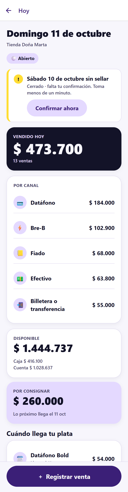

- **Registrar venta (pasos 2 y 3; H2, H7, H8).** Efectivo viene elegido, así que una venta en efectivo es escribir el monto y tocar "Guardar venta" (QA-04). Cada canal muestra su comisión y en cuántos días consigna, y una tarjeta dice antes de guardar cuánto se cobrará de comisión y cuándo llega la plata. En "Más opciones" se divide el pago entre dos medios (queda como una sola venta), se marca un anticipo con el valor total del pedido y se agrega una nota.

  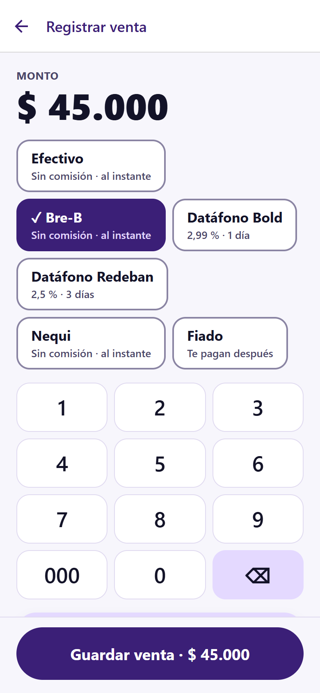 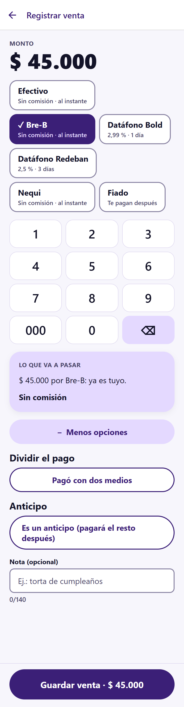 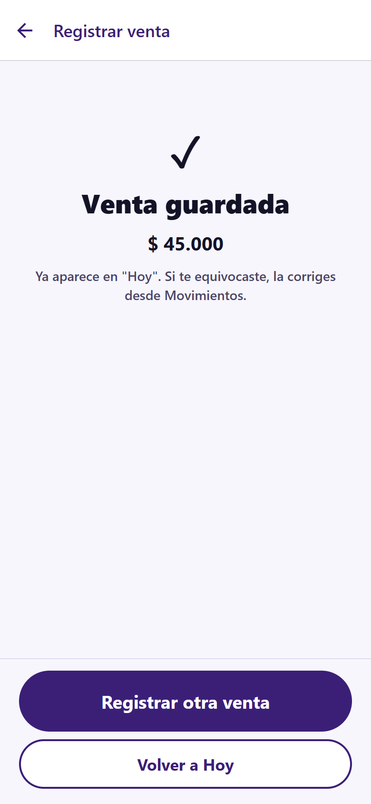

- **Movimientos del día (pasos 2 y 6).** La lista de todo lo que pasó hoy, con hora, canales y nota. Al tocar una venta se puede corregir: se agrega una "Corrección" visible que la anula, y la venta original se queda en la lista, tachada. Nada se borra ni se edita. Después se ofrece registrar la venta con el monto correcto.

  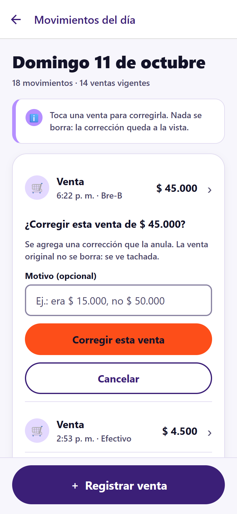 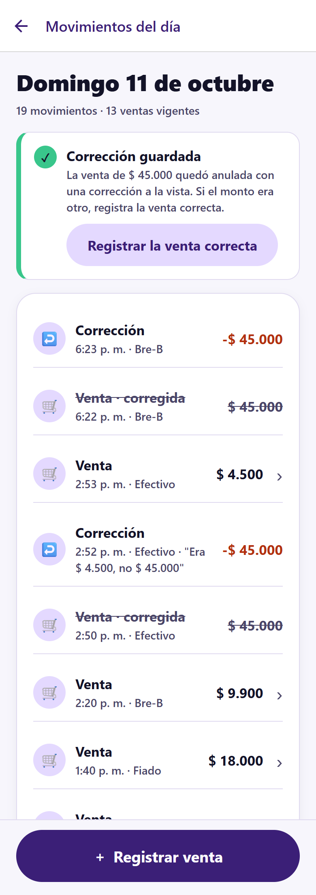

- **Cerrar el día (paso 5; H4).** Muestra cuánto debería haber en la caja y en la cuenta. El dueño escribe lo que contó (o toca "Está exacto") y, si quiere, lo que ve en su cuenta. Las diferencias aparecen con calma y con una posible explicación ("Puede ser un vuelto…"): un faltante o sobrante de caja queda como ajuste visible.

  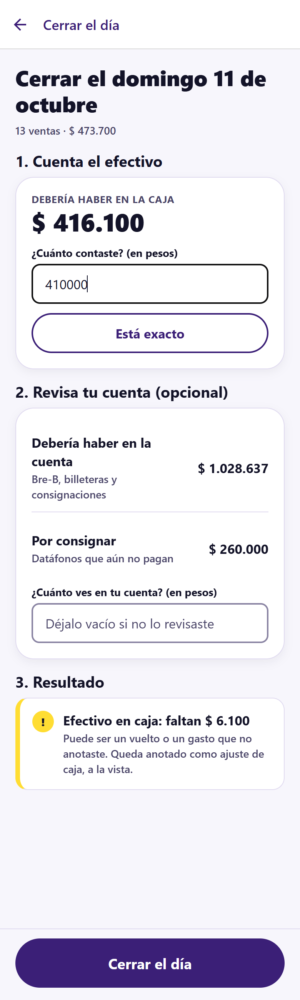

- **Confirmar y sellar (paso 6).** Resume el cierre en lenguaje humano ("Sellar sábado 10 de octubre: 6 ventas, $ 190.200"). Si hay varios días pendientes, se confirman todos con un solo "Confirmar con Face ID". Luego pasa por "Guardando tu cierre…" hasta "Sellado ✓", con los textos exactos del spec 07 §6. Face ID y el sello se simulan, y la pantalla lo dice con la etiqueta "Simulación".

  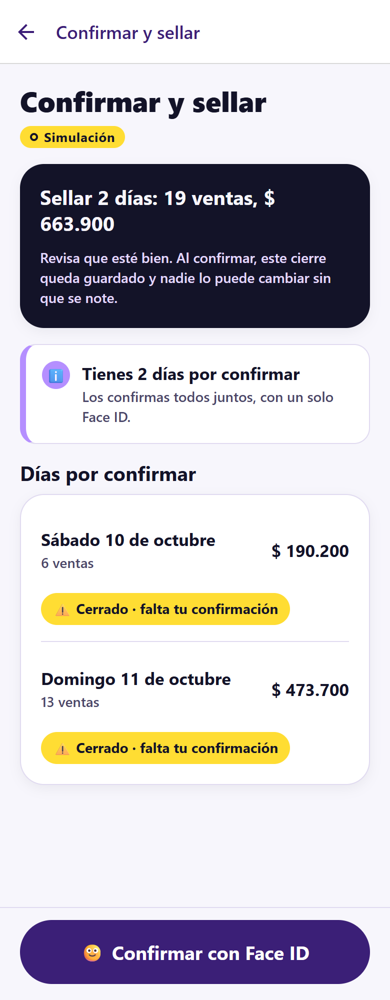 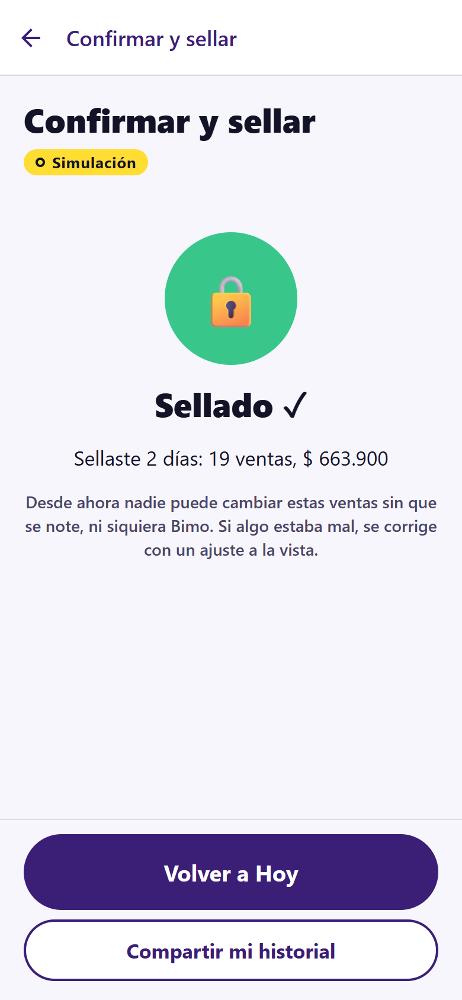

### Página del verificador

**`/verificar/demo` (paso 7 del Blueprint; H5; spec 05).** Es la página que abre el analista de un banco en su computador, sin crear cuenta, así que usa todo el ancho (en un celular se acomoda en una columna). Arriba, un encabezado oscuro con el nombre del negocio, el período y tres cifras: las ventas de los días que coinciden, el "% verificado por terceros" y el conteo de días ✅ coincide, ⚪ sin sellar y ❌ no coincide (spec 05 §4.1). Debajo, el resultado de cada día con su comprobante de sello, y las ventas por canal con barras, sumando **solo** los días que coinciden (spec 05 §4.2). Un recuadro "Prueba: ¿qué pasa si alguien cambia los datos?" deja elegir un día sellado y simular una alteración: el día pasa a ❌, sale de los totales y aparece un aviso. La sección "¿Cómo funciona?" explica en cuatro pasos simples cómo se sella y se comprueba; es el único lugar donde aparece la palabra Stellar. La comprobación es simulada en esta demo.

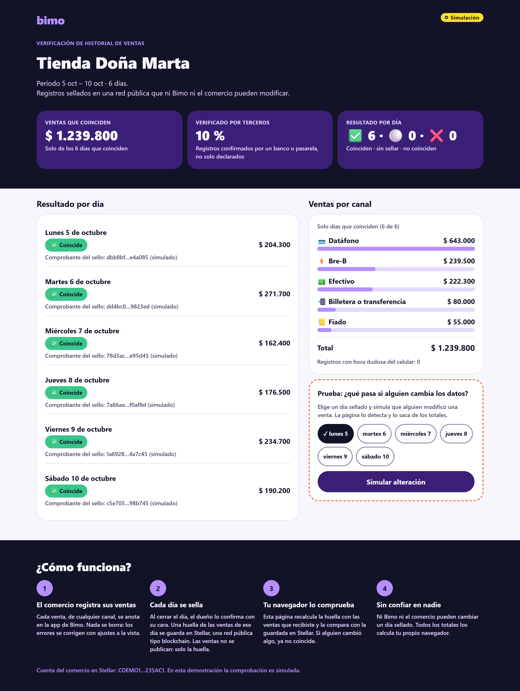

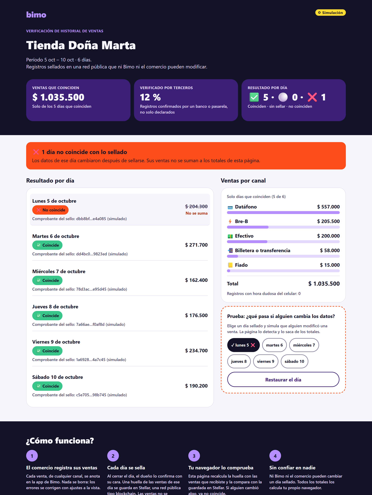

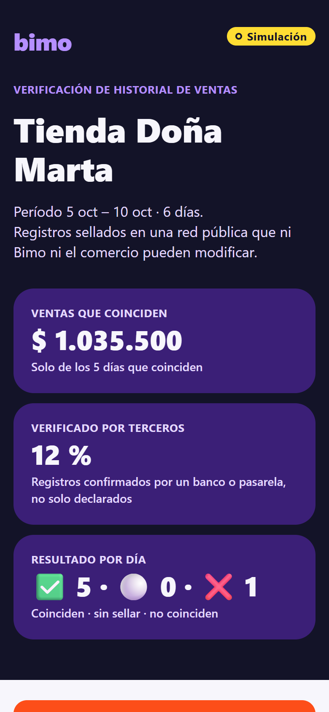

### Pantallas de configuración e historial

Estas cuatro pantallas cubren el arranque del negocio y lo que pasa después del día a día: ver el historial y compartirlo. Usan solo los hooks de `src/hooks/` y los componentes de `src/ui/`.

**Bienvenida y registro** (paso 1 del Blueprint). El dueño escribe el nombre del negocio y su correo. La app simula el envío de un código de 6 dígitos; en la demo sirve cualquiera. Al verificarlo, queda registrado y pasa a configurar canales. Si ya tenía cuenta, puede ir directo a "Hoy".

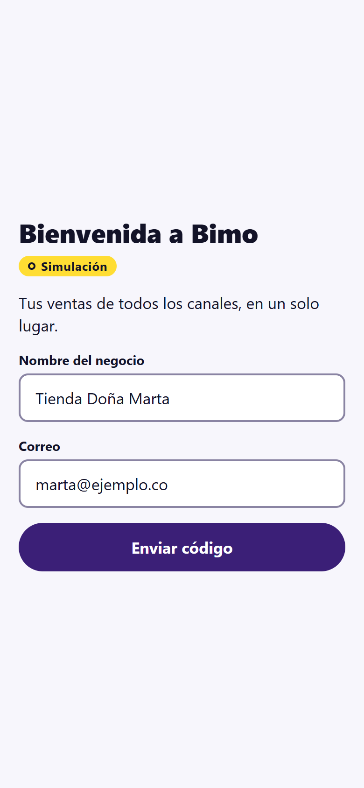 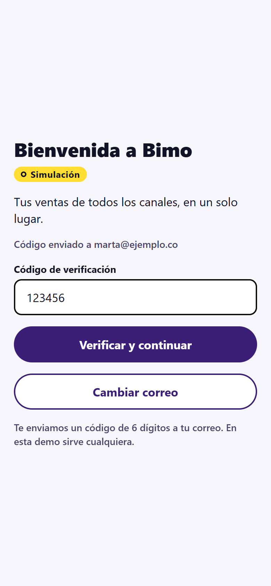

**Configurar canales** (paso 1 del Blueprint). Lista efectivo, Bre-B, datáfonos y billeteras. Por cada canal se puede encender o apagar, indicar la comisión en porcentaje y en cuántos días consignan. Eso alimenta después los cálculos de "pendiente de consignar" en "Hoy". Al terminar, entra al día a día.

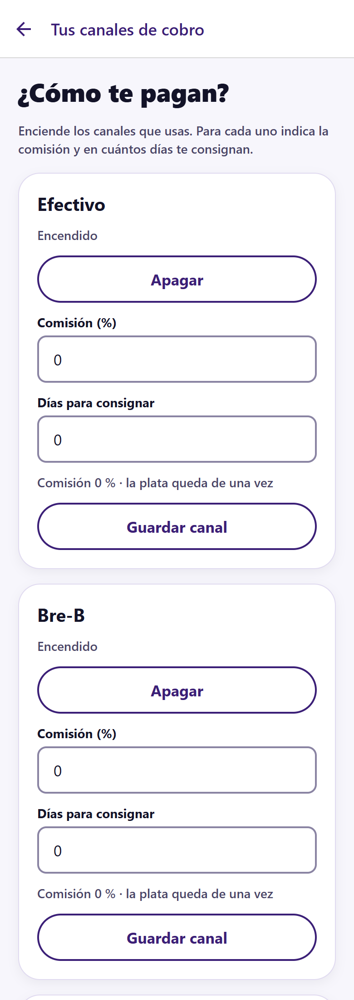

**Historial de días** (paso 6 del Blueprint). Muestra cada día con su total vendido y su estado, con los textos del spec 07 §6: "Abierto", "Cerrado · falta tu confirmación", "Sellado ✓" y "Llegaron ventas después del cierre · confirma de nuevo". Desde aquí se puede ir a compartir el historial.

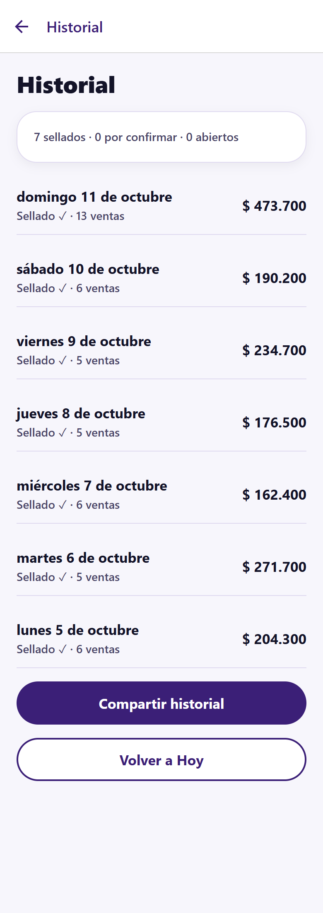

**Compartir historial** (paso 7 del Blueprint; spec 05 §2). El dueño elige el período y la vigencia del enlace (7, 30 o 90 días), lo genera (simulado) y lo comparte con la hoja del sistema; en web se copia al portapapeles. Ve la lista de enlaces creados, cuántas veces se abrieron y puede revocarlos. Hay un atajo a `/verificar/demo` para ver lo que vería el banco o el prestamista.

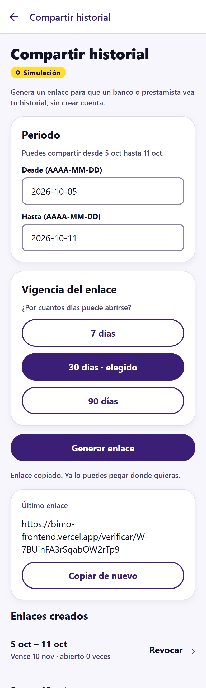

## 2. Decisión técnica

**Opción A: contrato propio, `bimo-registry`.**

**Qué hace.** `bimo-registry` es un registro de solo adición en Soroban. Por cada comercio y cada día guarda la **huella del cierre**: la raíz Merkle de los asientos del día, cuántos son y qué tan verificados están (spec 03 §4, ADR-06). Cada sello lleva **dos firmas**: la del dueño, con la llave de su celular, y la de Bimo como atestador. Así el comercio no puede negar lo que declaró y Bimo no puede sellar a su nombre. El contrato no tiene funciones para borrar ni modificar un sello, ni para actualizar su código (ADR-15). Si llega una venta de un día ya cerrado, se agrega una **enmienda**: una versión nueva del sello que deja visible la anterior. Cualquiera puede leer todas las versiones con `get(comercio, día)` sin pedirnos permiso. En la cadena solo van huellas, nunca montos ni datos personales.

**Por qué hace falta uno propio.** No encontramos una herramienta existente que guarde un sello **diario**, **por comercio** y **co-firmado** por el dueño y Bimo, que sea **inmutable**, mantenga visibles las versiones anteriores al enmendar y que **un tercero pueda verificar** leyendo la red directamente. Una transacción con memo guarda un hash, pero no impide sellar dos veces el mismo día ni exige las dos firmas. Los servicios genéricos de notarización no conocen el "día del comercio" ni sus versiones. Por eso el contrato es pequeño, hace solo esto y tiene pruebas exhaustivas (spec 03 §10): como es inmutable, un error no se puede corregir en sitio.

**Qué reutilizamos del ecosistema.**

- La **cuenta del comercio** es una smart account basada en `stellar-contracts` de OpenZeppelin (ADR-04). Solo la mueve la llave del celular del dueño; Bimo nunca es firmante.
- Las **comisiones de red** las paga el **OpenZeppelin Relayer** (ADR-09). El dueño nunca necesita tener ni entender XLM.

**Qué descartamos.**

- **La opción B pura**, solo con herramientas existentes: ninguna da la doble firma ni la regla de "un sello por día, con enmiendas visibles".
- **Una transacción por venta** (ADR-06): costaría por cada venta, agregaría espera al cobrar y dejaría ver en la cadena cuánto vende el negocio. Con un sello diario y un árbol Merkle con sal, se puede probar una venta sin revelar las demás.

## 3. Participación del equipo

<!-- Cada persona escribe solo su línea: usuario de GitHub y aporte -->

- `andreMD287` (André): esqueleto del front (proyecto Expo, navegación, hooks, datos de ejemplo y cálculos de "Hoy"), publicación en Vercel, integración de los PRs del equipo y las secciones de front, decisión técnica y bloqueos de este documento.
- `ricoththth` (Lizeth): sistema de diseño de la app (paleta Velto, tokens y componentes accesibles en `src/ui`, marco de teléfono para web), pantallas del día a día (Hoy, Registrar venta, Movimientos, Cerrar el día, Confirmar y sellar) y página del verificador, con su revisión de accesibilidad y contraste.
- `dpardogo` (Santiago): pantallas de bienvenida y registro, configurar canales, historial de días y compartir historial; `README.md` de la raíz.

## 4. Bloqueos y siguiente paso

- **Contratos en testnet y backend.** Esta semana no se escribieron contratos. El siguiente paso es el plan de `docs/prompts/02-arranque-andre.md`:
  1. Esqueleto del monorepo y CI (A-01).
  2. Migraciones de Supabase (A-02).
  3. Contratos `bimo-p256-verifier` y `bimo-registry` con sus pruebas (A-03, A-04).
  4. Despliegue en testnet (A-05).

  Después siguen `bimo-core` y la conexión de los hooks a la base local y al servidor (A-15 en adelante).
- **Canales y anticipos sin modelar en los specs (tarea A-00).** Los specs 01 y 04 todavía no modelan la configuración de canales del Blueprint (comisión y días de consignación por canal) ni los anticipos. Por ahora el front los muestra con datos que solo existen en `src/mocks/`. A-00 debe proponer el cambio a los specs antes de las migraciones, y el issue todavía hay que crearlo en el kanban.
- **Modelo contable del anticipo (A-00).** Para simplificar el front, un anticipo se registra como una venta dividida: lo recibido va a caja o a la cuenta, y el saldo queda en `por_cobrar_clientes` como algo que "te deben". A-00 debe decidir el modelo real, porque un anticipo de una cita (plata recibida antes de prestar el servicio) podría ser un **pasivo** y no una cuenta por cobrar.
- **Diferencias con el spec 05 en la demo.** En la demo, el token del verificador va en la ruta (`/verificar/demo`) y no en el fragmento `#t=…`. Además, la verificación es simulada: no lee Stellar ni recalcula el Merkle. Ambas cosas se corrigen al conectar `useVerificacion` con el paquete `shared` y con Stellar RPC.
